# MindDiary — Complete Project Documentation

**A Private, AI-Supported Journal for Mental Wellness**

> *What it is, how it works, every feature, the architecture, flowcharts, data model, safety design, security and setup.*  
> **Technology:** React + TypeScript (frontend) | Node.js + Express + MongoDB (backend) | Anthropic Claude (AI) *(note: documented as Anthropic Claude in the original PDF specification)*  
> **Prepared:** November 2026 from a code-level analysis of the project source.  
> **Disclaimer:** *MindDiary is a self-care support tool. It is not a doctor, a therapist, or an emergency service.*

---

## Table of Contents

1. [What is MindDiary? (Start here)](#1-what-is-minddiary-start-here)
2. [Problem, Goals and Design Principles](#2-problem-goals-and-design-principles)
3. [Complete Feature List](#3-complete-feature-list)
4. [System Architecture](#4-system-architecture)
5. [How the User Moves Through the App](#5-how-the-user-moves-through-the-app)
6. [Core Workflows (Flowcharts)](#6-core-workflows-flowcharts)
7. [Mental Health Features in Detail](#7-mental-health-features-in-detail)
8. [The Safety System](#8-the-safety-system)
9. [The AI Features](#9-the-ai-features)
10. [Privacy and Security](#10-privacy-and-security)
11. [Data Model (Database)](#11-data-model-database)
12. [API Reference (Summary)](#12-api-reference-summary)
13. [Frontend Design](#13-frontend-design)
14. [Setup, Configuration and Deployment](#14-setup-configuration-and-deployment)
15. [Testing, Quality and Current Status](#15-testing-quality-and-current-status)
16. [Glossary](#16-glossary)

---

## 1. What is MindDiary? (Start here)

**MindDiary** is a web application where a person can write a private digital diary and, at the same time, look after their mental wellbeing. It looks like a diary, but it also works like a gentle daily check-in tool: it helps the user notice how they feel, find patterns (for example *"I feel worse when I sleep less"*), calm down when they are stressed, and reach real help if they are in distress.

It is built for **students and young adults** who feel stress, anxiety or low mood but may not have a simple, private, low-pressure place to put their thoughts into words. It was created as a college project and is designed around three promises:

- **Private:** every user sees only their own data; sensitive text is encrypted in the database.
- **Gentle:** no guilt, no scary red warnings, no streak shaming; the wording is kind and simple.
- **Safe:** the app never diagnoses, never gives medical advice, and shows helplines whenever it detects signs of crisis.

> [!IMPORTANT]
> **Important to understand:**  
> MindDiary is a **support and self-reflection tool**. It is not a doctor, a therapist or an emergency service. Screening questionnaires inside the app (PHQ-9 and GAD-7) are screenings only, never a diagnosis. Wherever the app talks about help, it points to real helplines and real people.

### 1.1 The project at a glance

| Item | Detail |
| :--- | :--- |
| **Type** | Full-stack web application (works on phone and desktop browsers) |
| **Frontend** | React 18, TypeScript, Vite, Tailwind CSS, TipTap rich-text editor, Recharts (charts), jsPDF (PDF export), i18next (languages) |
| **Backend** | Node.js, Express 4, Mongoose 7 (MongoDB), JWT login, bcrypt, helmet, rate limiting |
| **Database** | MongoDB with 14 collections; private text encrypted with AES-256-GCM |
| **Cloud services** | Cloudinary (photos, videos, voice notes), Anthropic Claude (AI), SMTP email (password reset) |
| **Hosting plan** | Frontend on Vercel, backend on Render, database on MongoDB Atlas |
| **Size** | About 22,000 lines of code, 18 screens, about 50 API endpoints, 59 page and component files |
| **Languages in UI** | English and Hindi (interface language setting); voice dictation supports several languages |

### 1.2 A day in the life of a user (story)

**Aarav** is a second-year engineering student with exams coming up. This is how he might use MindDiary on one day:

- **Morning:** He opens the app. The *Dashboard* greets him and asks *"How are you feeling today?"*. He does a 10-second *quick check-in*: mood 5/10, stress 4/5, slept 5 hours.
- **Afternoon:** He feels overwhelmed. He opens *Calm space* and does a 4-7-8 breathing exercise, then types his angry thoughts into *Let It Go*, which fades them away and never saves them.
- **Evening:** He opens *Write*, presses the microphone and speaks about his day. The text appears in the editor. He adds a photo of his study desk and saves. The server cleans the text, encrypts it and stores it.
- **Night:** He uses the *Thought Challenger* to question the thought *"I will fail everything"*, and writes three things he is grateful for in the *Gratitude jar*.
- **End of week:** The *Insights* page shows his mood chart and a gentle finding: *"your mood seems higher on days you slept 7+ hours"*. The *Student* page shows a soft note about rest because his stress was high on five days.
- **If things ever feel too heavy:** the always-visible *SOS button* opens helplines for his country and his trusted contact, one tap away.

### 1.3 Who is this document for?

Anyone who has never seen the project: a teacher or examiner, a new developer, a counselor reviewing the approach, or a classmate. Parts 1–3 explain the idea and the features in plain words. Parts 4–8 explain how the system works inside, with flowcharts. Parts 9–16 cover AI features, privacy, data model, API, setup, quality, honest limitations, and a glossary of technical words.

### 1.4 How to read the flowcharts

All flowcharts in this document use consistent shapes and colors (read top-to-bottom or left-to-right following the arrows):

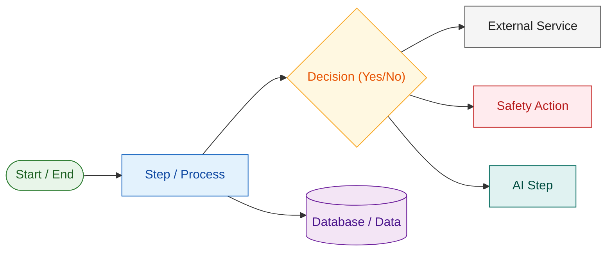
*Figure 1: Legend for all flowcharts*

---

## 2. Problem, Goals and Design Principles

### 2.1 The problem

Many students and young adults feel stress, worry and low mood, but they often do not talk about it. Existing apps either only store text (a plain diary) or push the person into heavy, clinical conversations. People also worry about **privacy**: who can read my feelings? And when a person is in real distress, a normal diary app does nothing at all.

### 2.2 The solution

MindDiary combines five ideas in a single private app:

| Idea | What it means in the app |
| :--- | :--- |
| **Journal** | Rich-text diary with photos, videos, voice notes and voice-to-text; calendar and search |
| **Check-in and tracking** | Daily mood, emotions, sleep, stress and habits; charts and simple, careful findings |
| **Calm and coping tools** | Breathing, grounding, muscle relaxation, ambient sounds, thought challenger, vent-and-let-go |
| **Gentle AI** | Reflection note, mood suggestion, companion chat, storybook of your own days (optional, off by default) |
| **Safety net** | Crisis-phrase detection, full-screen caring safety screen, SOS button, country-wise helplines, trusted contact |

### 2.3 Goals

- Give users a private, calm place to write and reflect every day.
- Help users understand their own patterns using simple statistics, not guesses.
- Offer practical coping tools that take 1–5 minutes.
- Make it easy to reach real help in a crisis, without judgement.
- Protect data: encryption, strict per-user access, export and permanent deletion.
- Stay honest: clear limits (not a doctor), clear explanation of what is and is not private.

### 2.4 Design principles

| Principle | How it shows up |
| :--- | :--- |
| **Never diagnose** | The word "screening" is used, never "diagnosis". AI is forbidden by its instructions from naming illnesses or medicines. |
| **Gentle wording** | Missed days do not "break" anything. Findings use soft words ("seems", "tends to") and need at least 7 check-ins. |
| **Privacy first** | Per-user data only; AI is OFF until the user switches it on; "Let It Go" text never leaves the browser. |
| **Safety always on** | The SOS button is on every page; risky text is checked before any AI call. |
| **Simple and calm UI** | Soft colors, large readable text, dark mode, bottom navigation bar on phones. |
| **User owns their data** | Download everything as JSON; delete the account and all data with one confirmed action. |

---

## 3. Complete Feature List

The table below lists every feature, where the user finds it (the page address), and what it does.

| Group | Feature | Page | What it does |
| :--- | :--- | :--- | :--- |
| **Account** | Sign up / Login | `/` (auth) | Create an account or sign in. Password rules: 8–72 characters with a letter and a number. |
| **Account** | Forgot / reset password | `/reset-password/:token` | Email link valid for 30 minutes and usable once. |
| **Account** | Settings | `/settings` | Theme (light/dark/system), font size and family, language (English/Hindi), voice language, country, trusted contact, reminders, AI on/off. |
| **Account** | Privacy and data control | `/privacy`, `/settings` | Plain explanation of data use; app lock PIN; download all data; delete account. |
| **Journal** | Dashboard | `/` | Greeting, how-are-you card, week mood strip, streak, recent entries, daily affirmation, mood-based music links. |
| **Journal** | Rich-text diary editor | `/write` | Bold/italic/lists/headings/quotes, word count, auto-saved drafts, focus mode, mood and emotion selection, tags. |
| **Journal** | Photos, video, voice notes | `/write` | Upload up to 10 items per entry; images are shrunk in the browser; gallery and player in each entry. |
| **Journal** | Voice to text | `/write` | Microphone button; speech turns into text at the cursor (browser speech recognition). |
| **Journal** | Writing prompts | `/write` | 30+ prompts (gratitude, tough day, anxiety, self-kindness, exams...) inserted with one tap. |
| **Journal** | Calendar | `/calendar` | Month view; days with entries are marked; click a day to read it. |
| **Journal** | Search and filter | `/search` | Search words, filter by mood, tags and date range. |
| **Journal** | Favorites, pins, Happy Box | `/happy-box` | Star happy entries; "On this day" memories from earlier years. |
| **Journal** | Export and backup | `/export` | Download entries as JSON; create an AI storybook and download it as PDF. |
| **Wellness** | Daily check-in | `/checkin` | Mood 1–10, emotion wheel, sleep, energy, stress, anxiety, tags and a short note. Quick or full mode. |
| **Wellness** | Emotion wheel | `/checkin`, `/write` | 6 core emotions (joy, love, sadness, fear, anger, surprise) with finer levels. |
| **Wellness** | Habit tracker | `/checkin` | Sleep hours and quality, water, exercise minutes, screen time. |
| **Wellness** | Gratitude jar | `/gratitude` | Three good things a day; a random past one on demand. |
| **Wellness** | Insights | `/insights` | Mood chart (7/30/90 days), emotion counts, weekday pattern, habit comparisons, "what I noticed" list, PDF/summary. |
| **Wellness** | Reminders | `/settings` | Optional, kind daily "want to check in?" browser notification. |
| **Calm** | Breathing | `/calm` | Animated circle; Box (4-4-4-4) and 4-7-8 techniques and others; session logged. |
| **Calm** | Grounding 5-4-3-2-1 | `/calm` | Guided senses exercise with typed answers. |
| **Calm** | Muscle relaxation | `/calm` | Step-by-step guided progressive relaxation with a timer. |
| **Calm** | Ambient sounds | `/calm` | Rain, ocean, forest and white noise generated in the browser, with volume and timer. |
| **Calm** | Thought Challenger (CBT) | `/calm` | Situation, thought, feeling strength, evidence for/against, balanced thought, feeling now. Works without AI. |
| **Calm** | Let It Go | `/calm` | Type anger or worry, watch it fade away. Never saved, never sent. |
| **Support** | Self-check PHQ-9 and GAD-7 | `/self-check` | Standard screening questionnaires, one question at a time, with gentle explanations and a trend chart. |
| **Support** | AI companion chat | `/chat` | Supportive conversation with memory of the last 10 messages; optional check-in context. |
| **Support** | AI reflection and mood hint | `/write` | "Reflect with me" note and a soft prompt when words and chosen mood do not match. |
| **Support** | Counselor summary link | `/settings`, `/shared/:token` | User creates a 7-day link with numbers only (no diary text) to show a counselor. |
| **Safety** | Crisis detection and safety screen | everywhere | Detects risky phrases (English, Hindi, Hinglish) and shows a caring full-screen message with helplines. |
| **Safety** | SOS button | every page | Always visible; helplines, trusted contact and a grounding exercise in one tap. |
| **Student** | Student mode | `/student` | Exam countdowns, Pomodoro study timer, burnout early notice, three small wins a day. |
| **AI** | AI storybook | `/export` | Turns diary entries from a date range into a short story in a chosen theme; preview, then download as PDF or text. |

---

## 4. System Architecture

MindDiary has three layers. The **frontend** runs in the user's browser. The **backend** is a server that applies the rules (login, validation, safety, encryption) and talks to the database and cloud services. The **data and external services** store information or perform special tasks (photos, AI, email).

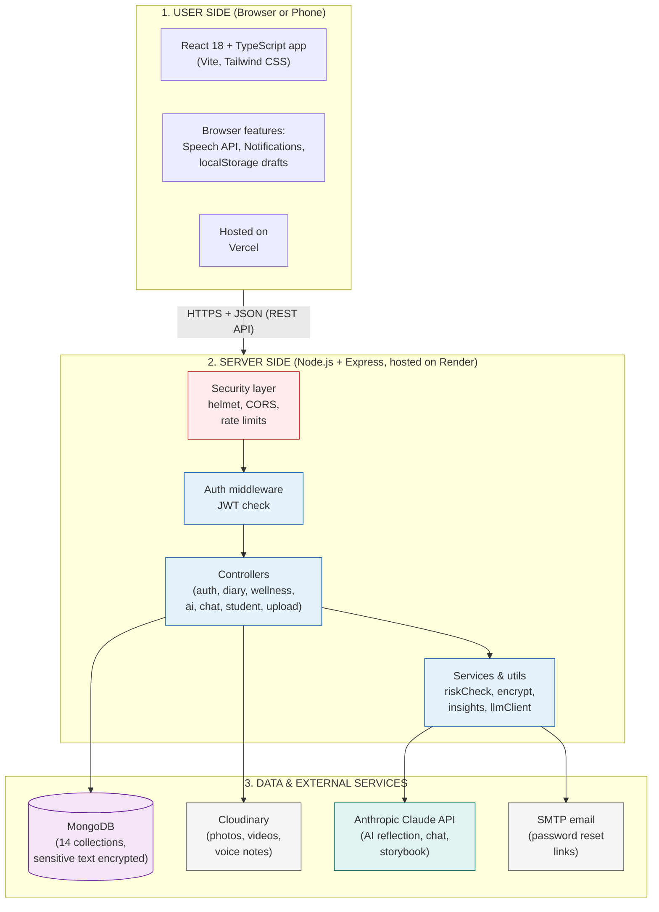
*Figure 2: Three-layer architecture of MindDiary (The server talks to each service; secret keys never reach the browser).*

### 4.1 Technology stack and why each piece is used

| Technology | Role | Why it was chosen |
| :--- | :--- | :--- |
| **React 18 + TypeScript** | User interface | Component based; TypeScript catches mistakes before the app runs. |
| **Vite** | Build tool | Very fast development server; splits the app into small files that load on demand. |
| **Tailwind CSS** | Styling | Quick, consistent design; easy dark mode. |
| **TipTap** | Rich-text editor | Modern editor with bold, lists, headings and extensions. |
| **Recharts** | Charts | Mood and habit charts in the Insights page. |
| **jsPDF** | PDF export | Creates the storybook and report PDFs inside the browser. |
| **i18next** | Languages | English/Hindi interface switch. |
| **Express 4** | API server | Simple, popular Node.js web framework. |
| **MongoDB + Mongoose** | Database | Flexible documents suit diary entries, check-ins and nested data. |
| **JWT + bcrypt** | Login security | Stateless login tokens; passwords stored only as slow hashes. |
| **helmet, CORS, rate limits** | Hardening | Safe HTTP headers, only allowed websites can call the API, protection against abuse. |
| **sanitize-html / DOMPurify** | XSS protection | Remove dangerous code from rich text on server and browser. |
| **Cloudinary** | Media storage | Photos and videos do not belong inside the database. |
| **Anthropic Claude** | AI | Reflection, chat, mood hints, thought reframing, storybook. |
| **Nodemailer** | Email | Password reset links. |

### 4.2 Project folder structure

```text
My-AI-Diary/
  package.json          (root scripts: dev, build, test, lint)
  .github/workflows/ci.yml  (automatic build and tests)
  docs/                 (API.md, report outline, viva Q&A, survey)
  frontend/src/
    pages/              18 screens (Dashboard, DiaryPage, CheckInPage, CalmPage, ...)
    components/         Auth, Diary, Wellness, Settings, Export, Search, common
    services/           API calls (auth, diary, wellness, ai, upload, student, export)
    contexts/           AuthContext, DiaryContext (shared state)
    hooks/              useSettings, useDiary, useSpeechToText, useReminders
    data/               emotions, prompts, quotes, questionnaires, helplines
    i18n/, utils/, types/, config/api.ts
  server/
    index.js            app setup, security, routes, health check
    config/             database.js, models.js (14 schemas), cloudinary.js
    routes/             auth, diary, wellness, ai, chat, student, upload, export
    controllers/        the logic behind each route
    services/           aiService, llmClient, safetyPrompt
    utils/              riskCheck, encrypt, insights, validate, fileType, email
    middleware/         auth (JWT check), errorHandler
    data/riskKeywords.js, scripts/, tests/
```

### 4.3 How one request travels (example: saving a diary entry)

| Step | Where | What happens |
| :---: | :--- | :--- |
| **1** | Browser | User presses Save. The service sends `POST /api/diary/entries` with the token in the `Authorization` header. |
| **2** | Server: security | `helmet` headers, CORS check, general rate limiter, JSON body parser (up to 10 MB). |
| **3** | Server: auth | The JWT is verified; the user id is attached to the request. Invalid or expired token gives `401`. |
| **4** | Server: controller | Checks title, content, mood, tags and media. Strips all tags from the title. Cleans the content HTML. |
| **5** | Server: model | The content is encrypted with AES-256-GCM by the schema setter and saved in MongoDB. |
| **6** | Server: stats | Word count, reading time, entry total and streak are updated on the user. |
| **7** | Server: safety | `riskCheck` runs on title and text; the response contains `safety.level` (`none`, `concern` or `high`). |
| **8** | Browser | The entry list is refreshed; if level is `concern` or `high`, the safety banner appears. |

---

## 5. How the User Moves Through the App

After login, the user sees a side menu (desktop) or a bottom bar (phone). The red **SOS button** floats on every page. Some pages (privacy, counselor report, password reset) can be opened without logging in.

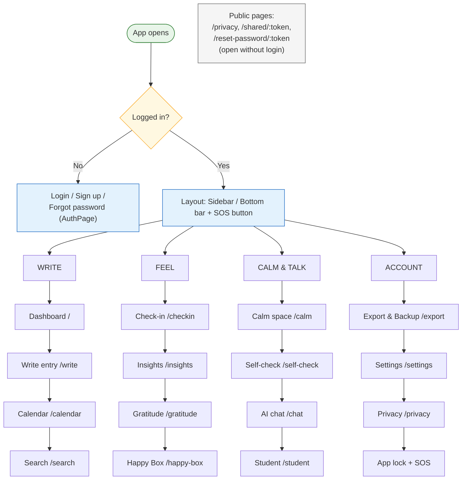
*Figure 3: Navigation map of all pages*

### 5.1 Page-by-page guide

| Page | Purpose and what the user can do | What happens behind the scenes |
| :--- | :--- | :--- |
| **Auth page** | Sign up, log in, request password reset. Show/hide password, clear error messages. | `POST /auth/register`, `/auth/login`, `/auth/forgot-password`. Token saved in the browser. |
| **Dashboard `/`** | Daily overview: greeting by time of day, check-in card, 7-day mood strip, writing streak, recent entries, affirmation, music links. | Loads entries and check-ins; affirmations come from a local list of 60+ quotes mapped to moods. |
| **Write `/write`** | Create or edit an entry: title, rich text, mood, emotions, tags, media, voice, prompts, AI helpers, focus mode. | Draft kept on the device; save sends cleaned, encrypted data; AI buttons call `/ai/*` only if allowed. |
| **Calendar `/calendar`** | See which days have entries and open them. | Uses entry dates; text preview strips HTML safely. |
| **Search `/search`** | Find entries by words, mood, tags and dates. | Server searches title and tags in the database and decrypts content in memory for the user's entries (up to 500). |
| **Check-in `/checkin`** | Quick or full daily check-in, plus the habit tracker. | One check-in and one habit log per day (saving again updates the same day). |
| **Insights `/insights`** | Mood chart, emotions, weekday pattern, habits vs mood, written findings, weekly report PDF, counselor summary. | `GET /wellness/insights` computes plain statistics; no AI is used. |
| **Gratitude `/gratitude`** | Write three good things; open the jar of past ones. | Items are encrypted; `"random"` returns one past item. |
| **Happy Box `/happy-box`** | Favorite entries and "On this day" memories. | Entries flagged `isFavorite`; same-date entries from earlier years. |
| **Calm `/calm`** | Six tabs: breathing, grounding, muscle relaxation, sounds, thought challenger, let it go. | Sound is generated in the browser; sessions logged (type, minutes); thought records encrypted. |
| **Self-check `/self-check`** | Take PHQ-9 or GAD-7 and read a gentle result; see past scores. | Score and severity band computed from the standard bands; saving is optional; any self-harm answer triggers the safety screen. |
| **Chat `/chat`** | Talk with the AI companion; quick-start chips; clear conversation. | Risk check, then Claude with a safety system prompt; 10-message memory; messages encrypted. |
| **Student `/student`** | Exam list with countdown, study timer, burnout notice, small wins. | Exams, study sessions and small wins stored per user; burnout rule evaluated on the last 7 days. |
| **Export `/export`** | Backup entries (JSON); generate and download an AI storybook. | `GET /export/entries`; `POST /ai/generate-storybook`; PDF built in the browser. |
| **Settings `/settings`** | Appearance, language, voice language, country, trusted contact, reminders, AI switch, app lock, data download, delete account. | `PUT /auth/settings` (also cached locally); app lock and account endpoints. |
| **Privacy `/privacy`** | Plain-language privacy and encryption explanation. | Static page, open without login. |
| **Shared report `/shared/:token`** | A counselor sees numbers only: averages, best/hardest day, correlations, screening scores. | Public route, valid by token for 7 days; contains no diary text. |

---

## 6. Core Workflows (Flowcharts)

### 6.1 Sign up

A new user chooses a name, email and password. The server validates everything, saves only a bcrypt hash of the password and returns a login token.  
*Safeguards on this step:* Max 10 sign-up/login tries per 15 minutes per IP; password is never stored as plain text.

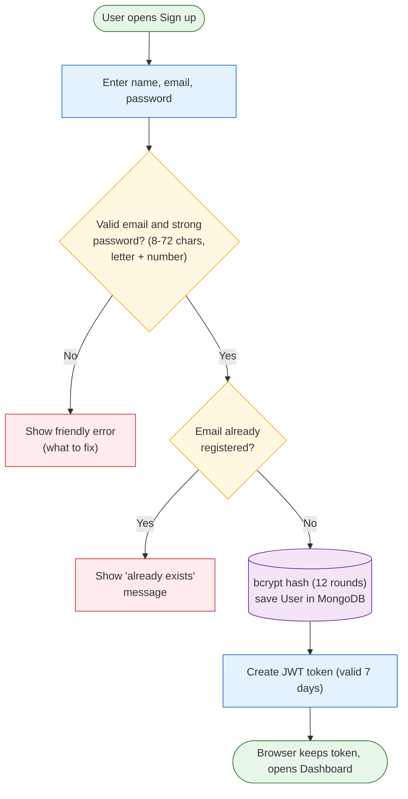
*Figure 4: Registration flow*

### 6.2 Login and keeping the session safe

Every request after login carries the token. The server checks it before doing anything. If the token is missing, wrong or expired (after 7 days), the server answers `401` and the app logs the user out and shows the login page. On app start the stored token is checked with `GET /auth/me`.

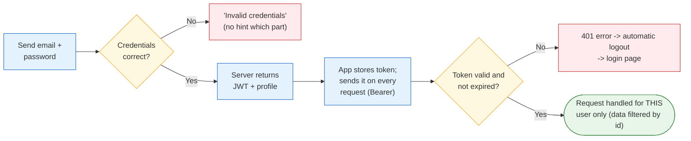
*Figure 5: Login and token check*

### 6.3 Writing and saving a diary entry

This is the most important workflow. Notice that saving is never blocked by safety checks: the entry is saved first, and care is shown on top.

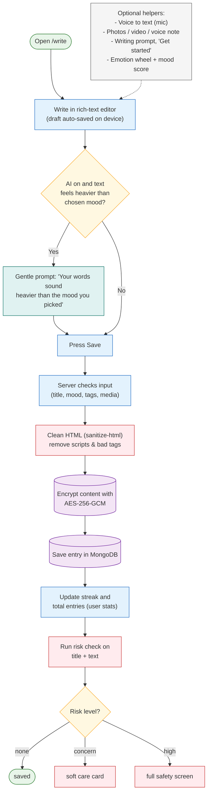
*Figure 6: Writing and saving a diary entry (Saving is never blocked by the risk level: the entry is saved and care is shown on top).*

### 6.4 Uploading a photo, video or voice note

*Limits:* images 5 MB, video 50 MB, voice notes 10 MB; at most 30 uploads per hour per user.

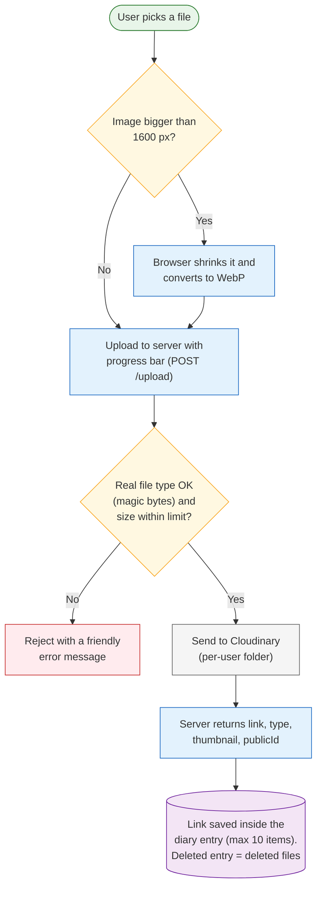
*Figure 7: Media upload flow*

### 6.5 Daily check-in, habits and insights

The check-in and habit data feed the Insights page. Findings appear only after at least seven check-ins so that a few days of data are not over-interpreted.

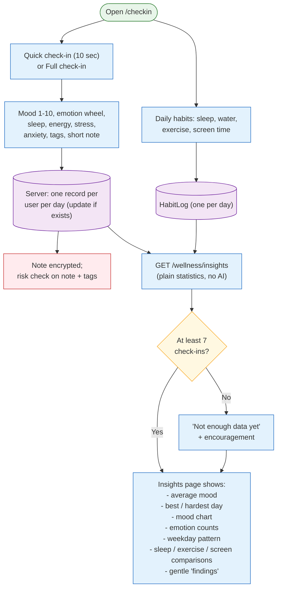
*Figure 8: Check-in, habits and insights*

### 6.6 Password reset

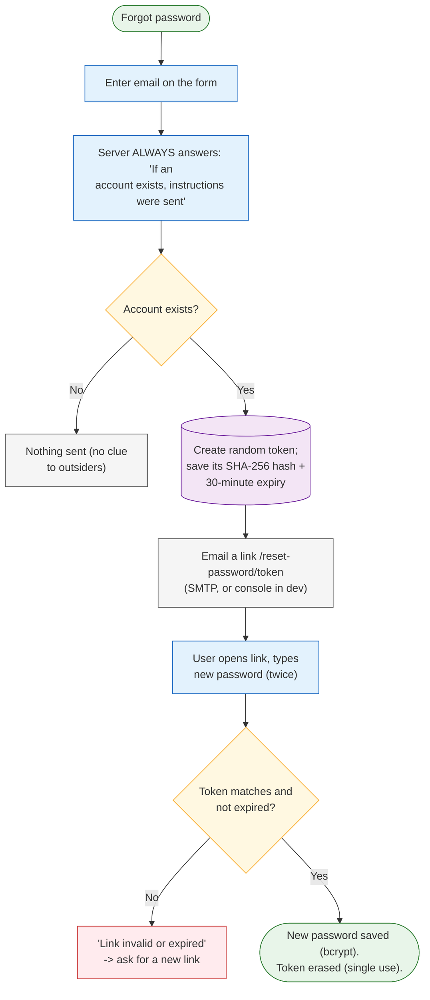
*Figure 9: Password reset flow*

---

## 7. Mental Health Features in Detail

### 7.1 Daily check-in and the emotion wheel

The check-in is the heart of the wellness side. The user chooses a **mood score from 1 to 10**, then selects emotions from an **emotion wheel**. The wheel starts with six core emotions (joy, love, sadness, fear, anger, surprise); each opens into more exact feelings (for example, fear can become worried, then nervous). Learning exact words for feelings is a known self-awareness skill. The user can also set **sleep hours, energy (1–5), stress (1–5) and anxiety (1–5)**, add quick tags like `"work"`, `"family"` or `"alone"`, and write a short note (up to 500 characters, encrypted). A **quick check-in** takes about ten seconds; a **full check-in** has every field. There is one check-in per day; saving again simply updates it.

Diary entries still use seven simple moods (happy, sad, neutral, excited, anxious, angry, peaceful), each with its own color and icon, so lists and the calendar stay colorful and easy to scan.

### 7.2 Habit tracker

Every day the user can record sleep hours and sleep quality, glasses of water, exercise minutes and screen time. These numbers are compared with mood in the Insights page.

### 7.3 Insights: how the findings are produced

The server computes **plain statistics, not AI guesses**. It returns the average mood, best and hardest day, mood per day, most frequent emotions, the tags that appear most on low days, a weekday pattern, and comparisons such as *"average mood is higher on days you slept 7 hours or more"*. A comparison is shown only when there are at least 7 data points. All sentences use careful words like *"seems"* and *"tends to"* and are never medical conclusions. If there is not enough data the app says so and encourages the user to keep checking in.

### 7.4 Gentle streaks

The app counts days with entries. A missed day quietly restarts the count at 1 instead of showing a failure message. The dashboard also shows *"days checked in this week"* so progress feels kind, not strict.

### 7.5 Gratitude jar and Happy Box

The **gratitude jar** asks for three good things a day and stores them encrypted. On a hard day the user can press a button to see a random past item. The **Happy Box** collects favorite entries (starred) and an **"On this day"** list showing what the user wrote on the same date in earlier years.

### 7.6 Writing prompts

More than 30 prompts help when the page feels empty. They are grouped by situation: gratitude, a tough day, anxiety, self-kindness, goals, exam stress, sleep and relationships. One tap inserts the prompt as a heading in the editor.

### 7.7 Calm space (six tools)

| Tool | How it works | Saved? |
| :--- | :--- | :--- |
| **Breathing** | An animated circle grows and shrinks with text cues. Techniques include Box breathing (4-4-4-4) and 4-7-8. Respects the "reduce motion" setting. | Session type and minutes only |
| **Grounding 5-4-3-2-1** | Guides the user to name 5 things they see, 4 touch, 3 hear, 2 smell and 1 taste. | Session only |
| **Muscle relaxation** | Short guided tense-and-release steps with a timer. | Session only |
| **Ambient sounds** | Rain, ocean, forest and white noise created with the browser audio engine (no copyrighted audio); volume, loop and timer. | No |
| **Thought Challenger** | Guided CBT steps: situation, automatic thought, feeling and strength (0–100), evidence for and against, a more balanced thought, feeling now. Works fully without AI; an optional button asks AI for another point of view. | Yes, encrypted |
| **Let It Go** | The user types anger or worry, then presses "Let it go" and the text fades or burns away. | Never saved or sent |

*(CBT — Cognitive Behavioral Therapy — is a well-known method where people examine how situations, thoughts and feelings connect. The Thought Challenger is a self-help worksheet in that style, not therapy.)*

### 7.8 Self-check questionnaires (PHQ-9 and GAD-7)

**PHQ-9** is a standard 9-question form about low mood; **GAD-7** is a standard 7-question form about anxiety. Each answer is scored 0–3 and the total is matched to the published score bands. The app shows one question per screen with a progress bar, the user can stop at any time, and saving the result is optional. Past scores appear as a trend.

| Questionnaire | Questions | Total score range | Score bands used |
| :--- | :---: | :---: | :--- |
| **PHQ-9 (low mood)** | 9 | 0 – 27 | 0–4, 5–9, 10–14, 15–19, 20–27 |
| **GAD-7 (anxiety)** | 7 | 0 – 21 | 0–4, 5–9, 10–14, 15–21 |

> [!WARNING]
> **Safety rule inside the self-check:**  
> Every result carries the line *"This is a screening, not a diagnosis. Please talk to a doctor or counselor."* If the PHQ-9 question about thoughts of self-harm is answered above zero, the full safety screen is shown immediately.

### 7.9 Student mode

Built for the main audience of the project. It has four parts:

- **Exam tracker:** add subject, date and notes; see a live "days left" countdown.
- **Study timer:** Pomodoro 25 minutes of focus and 5 minutes of break, with an animated ring and a breathing suggestion on breaks. Finished sessions are saved as study minutes.
- **Burnout early notice:** shown when stress is 4 or higher on 5 or more of the last 7 days and the average sleep is below 6.5 hours. It suggests rest, talking to someone and campus counselors. It never uses alarming or diagnostic words.
- **Three small wins:** a tiny daily checklist of three tasks to build a feeling of progress.

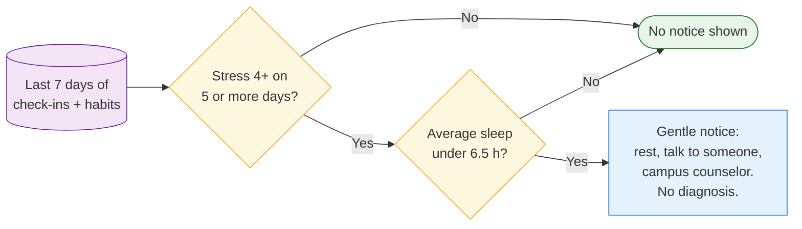
*Figure 10: Burnout early-notice rule*

### 7.10 Other supportive extras

- **Daily affirmation card:** 60+ original or public-domain lines chosen by mood.
- **Mood-based music links:** opens a search on YouTube or Spotify for calm or uplifting music; nothing copyrighted is embedded.
- **Kind reminders:** optional browser notification at a time the user picks. The wording is encouraging and there is no guilt for missing it.
- **Counselor summary link:** the user can create a link valid for 7 days that shows only numbers (averages, best/hardest day, correlations, screening scores).

---

## 8. The Safety System

For a mental health app, safety is the most important part. MindDiary has several layers that work together.

### 8.1 Layer 1: Crisis phrase detection (`riskCheck`)

A function on the server scans text for phrases that suggest self-harm, suicide or deep hopelessness. The phrase lists are kept in a separate file in English and in common Hindi and Hinglish expressions. The text is first lowercased, HTML is removed, punctuation is ignored and stretched letters (`"suuuicide"`) are collapsed. The result is one of three levels:

| Level | Examples of what triggers it | What the app does |
| :--- | :--- | :--- |
| `none` | Normal journaling | Nothing special. |
| `concern` | Phrases like feeling hopeless or overwhelmed | A soft caring card with kind words and links to Calm space, chat and helplines. |
| `high` | Direct self-harm or suicide phrases, or method questions | A full-screen caring safety screen. The AI is not called for this text. |

Risk checking runs on diary entries, check-in notes and tags, chat messages, and text sent to AI features. **Matched words are never stored or logged.**

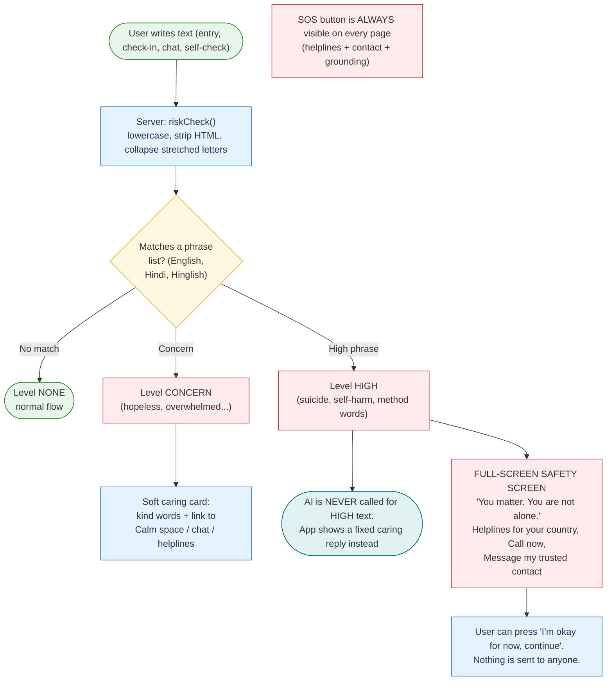
*Figure 11: Crisis detection and safety response (Matched words are never stored or logged; the app never contacts anyone by itself. This is a keyword safety net, not a medical test).*

### 8.2 Layer 2: The safety screen, SOS button and helplines

- **Safety screen:** says *"You matter. You are not alone."*, shows helplines for the user's country with a *"Call now"* button, a button to message the trusted contact, and *"I'm okay for now, continue"*. It does not judge.
- **SOS button:** a small button on every page. It opens helplines, the trusted contact and a short grounding exercise.
- **Helplines:** lists exist for India, USA, UK, Canada, Australia and a global fallback. For India the list includes Tele-MANAS (14416). The country is chosen in Settings.
- **Trusted contact:** name, phone and relation saved by the user. The app never contacts that person by itself; it only opens the phone or messaging app when the user taps.

> [!CAUTION]
> **Always verify helpline numbers:**  
> Helpline numbers change. The source file carries a "verify every number before release" warning. Before showing the project to anyone, check each number on the official website and record the date.

### 8.3 Layer 3: Safe AI behavior

- AI features are **off by default**; the user must switch them on in Settings.
- Text is risk-checked **before** any AI call; high-risk text never reaches the AI.
- A shared **system prompt** forbids diagnosis, medication advice, claiming to be human or a therapist, and any self-harm method information.
- If the AI senses severe distress it adds a marker that makes the app show the safety screen.
- The AI answers in the user's language (English, Hindi or Hinglish), asks at most one gentle question and suggests only tiny actions.

### 8.4 Layer 4: Honest limits

A keyword list is a safety net, not a medical test. It can miss some sad texts and can flag some harmless ones (for example a news story). The app therefore never claims to detect or diagnose anything, and every wellness page shows a disclaimer that MindDiary is not a doctor or an emergency service.

---

## 9. The AI Features

All AI calls are made from the **server** to the AI provider API. The secret API key lives only in the server environment and is never sent to the browser. The model name is read from an environment variable so it can be changed without editing code.

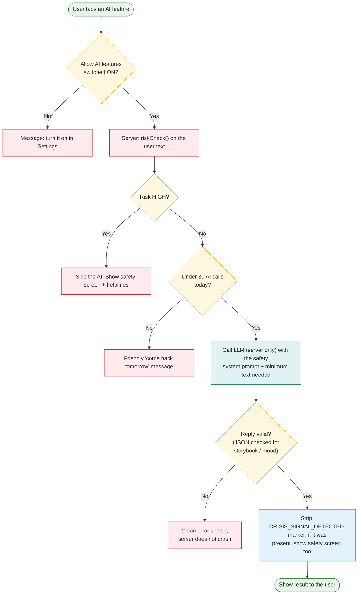
*Figure 12: Pipeline that every AI request passes through (Development only: without an API key the server returns demo replies).*

### 9.1 The five AI features

| Feature | Where | Input sent (minimum) | Output |
| :--- | :--- | :--- | :--- |
| **Reflect with me** | Entry view | Entry text (max 1500 characters) and mood | A short kind note and one reflective question |
| **Mood suggestion** | Editor | Text (max 1000 characters) | Suggested emotions, a score 1–10 and confidence. Only a hint; never changes the user's choice. |
| **Companion chat** | `/chat` | Last 10 messages; optional today's mood/stress/energy/sleep | A warm, short reply. Messages are encrypted when saved. |
| **Thought reframe** | Thought Challenger | The thought and evidence typed by the user | 2–3 gentle alternative viewpoints |
| **Writing starters** | Editor | A prompt | Three opening sentences to choose from |
| **Storybook** | `/export` | Titles, plain text (up to 1000 characters each), dates, moods, theme | A short story: title, protagonist, 3–6 chapters |

### 9.2 Cost and safety controls

- **Daily limit:** 30 AI calls per user per day, then a friendly message.
- **Timeout and retry:** 25 seconds with automatic retry; friendly messages for timeouts and overload.
- **Input limits:** chat input up to 2000 characters; excerpts are cut to a safe size.
- **Strict output checks:** storybook and mood answers must be valid JSON in the expected shape.
- **Development mode:** if no API key is configured while developing, the server returns clearly canned demo replies so the app can be shown offline.

### 9.3 Storybook generation in detail

The storybook turns real diary days into a short, kind story. The user picks a theme (`romantic`, `dramatic`, `adventure`, `mystery` or `comedy`), a start and end date, and an optional protagonist nickname (the default is `"The Traveler"`). The AI is told to stay faithful to the real events and never to invent harm.

```mermaid
flowchart LR
    S1["1. Choose theme,\ndate range and\noptional nickname"] --> S2[("2. Server loads your\nentries in that range\n(decrypted in memory)")]
    S2 --> S3["3. Entries cleaned\n(max 1000 chars each)\nriskCheck: HIGH = stop"]
    S3 --> S4["4. AI writes JSON:\ntitle, protagonist,\n3-6 chapters"]
    S4 --> S5["5. JSON checked, turned\ninto markdown with\n'## Chapter' headings"]
    S5 --> S6[("6. Saved as a Storybook\ndocument in MongoDB")]
    S6 --> S7(["7. Preview card on the\nExport page with PDF\nand Text buttons"])
    S7 --> S8(["8. PDF built in the browser\n(title page, contents,\nchapters, photo gallery)"])

    style S1 fill:#e3f2fd,stroke:#1565c0
    style S5 fill:#e3f2fd,stroke:#1565c0
    style S2 fill:#f3e5f5,stroke:#6a1b9a
    style S6 fill:#f3e5f5,stroke:#6a1b9a
    style S3 fill:#ffebee,stroke:#c62828
    style S4 fill:#e0f2f1,stroke:#00695c
    style S7 fill:#e8f5e9,stroke:#2e7d32
    style S8 fill:#e8f5e9,stroke:#2e7d32
```
*Figure 13: Storybook generation, from choosing a theme to the downloaded PDF*

#### Step by step

| Step | Where | What happens |
| :---: | :--- | :--- |
| **1** | Export page | The "AI Storybook" card needs the AI switch (Settings) to be ON; otherwise it shows a short message. |
| **2** | Browser | The user chooses theme, dates and nickname. The browser checks the dates and that some entries fall in the range. |
| **3** | Server | `POST /ai/generate-storybook` validates the theme and dates, then loads only this user's entries in the range (decrypted in memory). |
| **4** | Server | Each entry is cleaned: HTML removed, text cut to 1000 characters, title to 100, date and mood added. `riskCheck` runs on all the text. |
| **5** | Server | The daily AI limit (30) is checked, then the AI is called with the storybook instructions (kind story author, faithful to real events, JSON only), up to 2500 tokens. |
| **6** | Server | The JSON answer (title, protagonist, 3–6 chapters) is checked and turned into markdown: `"# Title"`, `"**Protagonist:**"`, then `"## Chapter title"` and text for each chapter. |
| **7** | Server | A Storybook document is saved (title, theme, dates, text, chapters, word and page counts). |
| **8** | Browser | A preview card shows the title and the story with action buttons: Export PDF and Export Text. |
| **9** | Browser (jsPDF) | The PDF has a decorated title page, a dedication page, a table of contents with Roman numerals, chapter headings, justified paragraphs, header and footer with page numbers, and a "Memories and Attached Media" gallery with photos from the chosen entries. |

#### Historical gaps documented in the initial PDF audit *(subsequently closed in codebase updates)*

- Saved storybooks had no list/reopen/delete UI (now `/stories` library & `StoryReader`).
- Preview showed raw markdown (now formatted chapters & reader).
- End date at midnight missed same-day entries (now `endOfDay` UTC / timezone-aware).
- No individual entry picker, length, language, or tone options (now supported).
- Invalid JSON substituted generic template story (now retries once then returns 503 + refunds quota).
- Storybook text was unencrypted in DB (now AES-256-GCM encrypted).

---

## 10. Privacy and Security

### 10.1 Who can see what

Every database query includes the logged-in user's id, so one user cannot read or change another user's data. No staff-facing screens exist: there is no admin panel in the app.

### 10.2 Encryption at rest

Sensitive text is encrypted with **AES-256-GCM** before it is saved. Each value gets its own random initialization vector and an authentication tag, so tampering is detected. Stored values look like `enc:v1:<iv>:<tag>:<cipher>` (and `enc:v2:<kid>:<iv>:<tag>:<cipher>` for key rotation). The key comes from the server setting `ENCRYPTION_KEY`.

| Encrypted in the database | Not encrypted (still private to the user, but readable in the database) |
| :--- | :--- |
| Diary entry text, check-in notes, gratitude items, chat messages, Thought Challenger fields *(and in updated code: storybook text, self-check answers, exam notes, small-win text, coping plan, future letters)* | Entry titles, tags, mood, dates, numbers (sleep, stress) |

> [!NOTE]
> **An honest note about encryption:**  
> Because the server holds the key, encryption protects against leaked database backups and direct database access. It does **not** stop the server itself from reading data, and it is not "end-to-end" encryption. If the key is lost, encrypted entries cannot be recovered, so it must be backed up safely.

### 10.3 Protections in one table

| Threat | Protection in MindDiary |
| :--- | :--- |
| **Password theft** | Passwords stored only as bcrypt hashes (12 rounds); 8–72 characters, letter + number required. |
| **Guessing passwords** | Login/sign-up/reset limited to 10 tries per 15 minutes per IP; general API limit 100 requests per 15 minutes in production. |
| **Stolen or stale sessions** | JWT valid 7 days; expired token = automatic logout. |
| **Malicious code in text (XSS)** | Server cleans HTML (allow-list of tags); browser cleans again with DOMPurify before showing rich text. |
| **Bad input / injection** | Server checks type and length of fields, allowed moods, tags; search text is escaped; non-string values are rejected. |
| **Other websites calling the API** | CORS allows only the configured frontend addresses; `helmet` adds secure headers. |
| **Fake files** | Uploads checked by real file signature (magic bytes), not just file name; size limits; uploads only from logged-in users; 30 per hour. |
| **Over-use of AI** | AI off by default; 30 calls per user per day. |
| **Forgotten-password abuse** | Reset token is random, only its SHA-256 hash is stored, expires in 30 minutes, single use; response never reveals if an email exists. |
| **Someone picks up the unlocked phone** | Optional app-lock PIN (4–6 digits); 5 wrong tries freeze it for 60 seconds; reset needs the account password. |
| **Losing control of data** | Download all data as JSON; delete account removes every collection and Cloudinary files; entry deletion removes its media. |

### 10.4 Counselor summary sharing

A user can create a link to show a counselor a numbers-only summary. The summary contains: the time range, number of check-ins, average mood, best and hardest day, mood per day, habit comparisons and recent screening scores. It **never** includes diary text. The link works for 7 days and can be revoked.

### 10.5 App lock

The app lock is a screen lock on the user's device. It asks for a PIN after inactivity (user-chosen timeout) and when the app is reopened. It protects against casual snooping on an unlocked device; it is not an additional encryption layer.

---

## 11. Data Model (Database)

MongoDB stores data as documents grouped into collections. Every collection except `User` holds a field `user` that points to the owner. `(ENC) = AES-256-GCM encrypted text`.

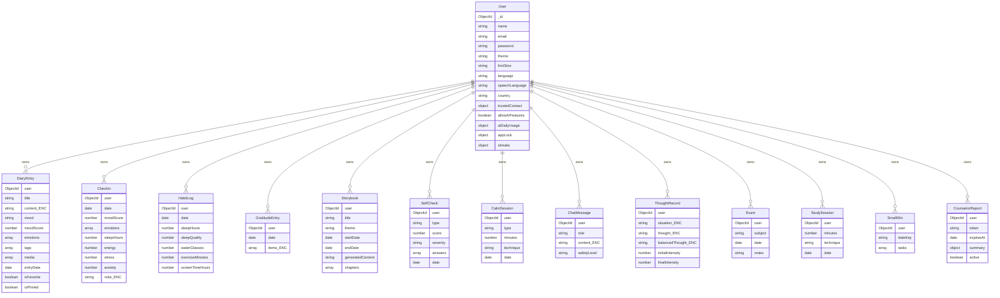
*Figure 14: Collections and relationships (`_ENC` = AES-256-GCM encrypted text)*

| Collection | Main fields | Notes |
| :--- | :--- | :--- |
| **User** | name, email, password hash, settings, trusted contact, app-lock data, AI permission and daily usage, streak stats | Email unique; password hashed by a save hook |
| **DiaryEntry** | title, content, mood, moodScore, emotions, tags, media[], entryDate, wordCount, isFavorite, isPinned | Indexed by user and date; up to 10 media items |
| **CheckIn** | date, moodScore, emotions, sleepHours, energy, stress, anxiety, tags, note | Unique per user per day |
| **HabitLog** | date, sleepHours, sleepQuality, waterGlasses, exerciseMinutes, screenTimeHours | Unique per user per day |
| **GratitudeEntry** | date, items (max 3, 200 characters each) | Encrypted items |
| **Storybook** | title, theme, date range, generated text, chapters, protagonist, download count | Themes: romantic, dramatic, adventure, mystery, comedy |
| **SelfCheck** | type (PHQ-9 or GAD-7), score, severity, answers, date | Saved only if the user chooses |
| **CalmSession** | type, minutes, technique, date | Used for insights |
| **ChatMessage** | role, content, safetyLevel | Encrypted content |
| **ThoughtRecord** | situation, thought, emotion, intensities, evidence, balanced thought, aiAssisted | Most fields encrypted |
| **StudySession** | minutes, technique, date | Pomodoro records |
| **Exam** | subject, date, notes | Countdown list |
| **SmallWin** | dateKey, tasks (3) | Unique per user per day |
| **CounselorReport** | token, summary (numbers), expiresAt, active | Public read by token, 7-day expiry |

*(Note: Updated codebase also adds `FutureLetter` and `CopingPlan`, bringing the total to 16 collections.)*

---

## 12. API Reference (Summary)

All routes start with `/api`. Unless marked public, every route needs a valid login token. Responses use the shape `{ success, message, data }`.

| Group | Method and path | Purpose |
| :--- | :--- | :--- |
| **Auth** | `POST /auth/register`, `POST /auth/login` | Create account / sign in (rate limited) |
| **Auth** | `GET /auth/me`; `PUT /auth/settings` | Current user; save settings |
| **Auth** | `POST /auth/forgot-password`, `/auth/reset-password` | Password reset (public, rate limited) |
| **Auth** | `POST /auth/app-lock/setup \| verify \| disable` | PIN lock |
| **Auth** | `GET /auth/export-data`; `POST /auth/delete-account` | Download all data; erase account |
| **Diary** | `GET, POST /diary/entries` | List (paged, filters, search) / create entry |
| **Diary** | `GET, PUT, DELETE /diary/entries/:id` | Read / update / delete one entry |
| **Diary** | `GET /diary/tags`; `GET /diary/stats` | Tag list; mood statistics |
| **Upload** | `POST /upload`; `DELETE /upload/*` | Upload media (multipart) / delete media |
| **Wellness** | `POST, GET /wellness/checkins`; `GET /wellness/checkins/today` | Check-ins |
| **Wellness** | `POST, GET /wellness/habits`; `GET /wellness/habits/today` | Habit logs |
| **Wellness** | `POST, GET /wellness/gratitude`; `GET .../random`; `DELETE .../:id` | Gratitude jar |
| **Wellness** | `POST /wellness/favorites/:id`; `POST /wellness/pins/:id`; `GET /wellness/happy-box` | Favorites and Happy Box |
| **Wellness** | `GET /wellness/insights?range=week\|month\|3months` | Statistics and findings |
| **Wellness** | `POST /wellness/calm-sessions`; `POST, GET /wellness/self-checks` | Calm session log; PHQ-9/GAD-7 results |
| **Wellness** | `POST, DELETE /wellness/counselor-share`; `GET /wellness/shared/:token` (public) | Counselor summary link |
| **Wellness** | `GET /wellness/year-pixels`; `GET, PUT /wellness/coping-plan` | Year in Pixels mood grid; personal coping plan |
| **AI** | `POST /ai/generate-storybook`; `GET /ai/storybooks`; `GET, PUT, DELETE /ai/storybooks/:id` | Storybooks |
| **AI** | `POST /ai/ask-diary`; `GET, DELETE /ai/ask-diary/history` | Ask My Diary Q&A and history |
| **AI** | `POST /ai/reflect \| analyze-mood \| challenge-thought \| writing-starters` | AI helpers |
| **AI** | `GET /ai/usage`; `GET, POST /ai/thoughts`; `DELETE /ai/thoughts/:id` | Usage counter; thought records |
| **Chat** | `GET, POST, DELETE /chat/messages` | Companion chat |
| **Letters** | `GET, POST /letters`; `GET /letters/due`; `GET, DELETE /letters/:id` | Future letters |
| **Student** | `GET, POST /student/exams`; `DELETE /student/exams/:id` | Exams |
| **Student** | `POST /student/study-session`; `GET /student/study-stats`; `GET /student/burnout-status` | Study timer and burnout rule |
| **Student** | `GET, POST /student/small-wins` | Three small wins |
| **Export** | `GET /export/entries`; `POST /export/storybook/:id/download` | Entry export; storybook download counter |
| **System** | `GET /health`; `GET /` | Health check (includes database state) |

**Common error answers:** `400` (invalid input), `401` (not logged in or expired), `403` (not allowed, or AI turned off), `404` (not found), `429` (too many requests or daily AI limit), `503` (AI temporarily unavailable).

---

## 13. Frontend Design

### 13.1 Structure and state

- **Pages** are loaded on demand (code splitting), so the first screen opens quickly.
- **AuthContext** keeps the logged-in user and token; on startup it validates the stored token and logs out on a `401` answer.
- **DiaryContext / useDiary** keeps the entry list in one place and supports paged loading.
- **useSettings** keeps appearance and preference settings, applies the dark class and font choices to the page, and saves a copy on the device.
- **Services** are small files that call the API and convert dates and field names.
- **ErrorBoundary** shows a calm recovery screen if a screen crashes.

### 13.2 Look and feel

- Calm palette (soft blue, sage and lavender) with a readable body font and a serif font for diary text.
- Dark mode and system-theme following; font size and family choices.
- Bottom tab bar on phones; side menu on desktops; always-present SOS button.
- Skeleton loaders, empty-state screens, toast messages and confirmation dialogs instead of browser pop-ups.
- Respect for reduced-motion preferences; labels and focus rings for keyboard and screen-reader users.

### 13.3 Working in the browser

- **Voice to text:** uses the browser speech recognition feature (best in Chrome and Edge). A microphone button shows a listening animation, and the language is chosen in Settings.
- **Drafts:** text in the editor is saved on the device every few seconds so a refresh does not lose it.
- **Image compression:** images over 1600 pixels are shrunk and converted to WebP before upload.
- **Sounds:** calming sounds are generated with the browser audio engine.
- **PDF:** storybook and reports are built in the browser with `jsPDF`.
- **Notifications:** daily reminders use the browser notification permission.

### 13.4 Languages

The interface language setting offers English and Hindi using `i18next`, with translation files for both. Voice dictation supports additional languages (for example English-India, Hindi, Spanish, French).

---

## 14. Setup, Configuration and Deployment

### 14.1 Run it on your own computer

1. Install Node.js (version 20.19+ recommended) and have a MongoDB database ready (local or a free MongoDB Atlas cluster).
2. In the project root run: `npm run install:all`
3. Create `server/.env` from `server/.env.example` and fill in the values below.
4. Start both parts together: `npm run dev` (server on port 5000, frontend on port 5173).
5. Open `http://localhost:5173` in the browser, then sign up.
6. Run tests with `npm test` and build the frontend with `npm run build`.

### 14.2 Environment variables (`server/.env`)

| Variable | Meaning |
| :--- | :--- |
| `PORT`, `NODE_ENV` | Server port; `development` or `production` |
| `MONGODB_URI` | Database connection string (required) |
| `JWT_SECRET` | Secret for login tokens, at least 32 characters (required) |
| `JWT_EXPIRES_IN` | Token lifetime, for example `7d` |
| `FRONTEND_URL`, `CORS_ORIGIN` | Website address(es) allowed to call the API |
| `ENCRYPTION_KEY` | 32-byte key (64 hex characters) for AES-256-GCM. Back it up safely; losing it loses encrypted data. |
| `CLOUDINARY_CLOUD_NAME`, `_API_KEY`, `_API_SECRET` | Media storage |
| `ANTHROPIC_API_KEY` / `GEMINI_API_KEY`, `AI_MODEL` | AI access and model name |
| `SMTP_HOST`, `SMTP_PORT`, `SMTP_USER`, `SMTP_PASS`, `EMAIL_FROM` | Email for password reset (in development the link is printed in the server console) |
| **Frontend:** `VITE_API_URL` | Address of the API (default `http://localhost:5000/api`) |

### 14.3 Deployment

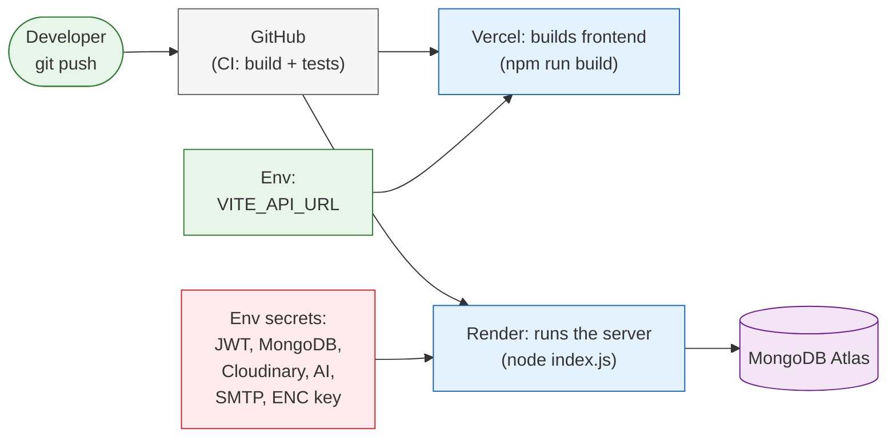
*Figure 15: Deployment overview (Browser loads the app from Vercel, then calls the Render API).*

- **Frontend:** Vercel builds the project and serves the static files. Set `VITE_API_URL` to the Render address.
- **Backend:** Render runs `node index.js` with all server variables set; add the Vercel address to `CORS_ORIGIN`.
- **Database:** MongoDB Atlas; keep regular backups and store the `ENCRYPTION_KEY` separately.
- **Check after deploy:** `/api/health`, sign-up, password-reset email, media upload, AI reply, SOS button.
- Free hosting plans may "sleep"; the first request after a pause can be slow.

### 14.4 Automatic checks (CI)

A GitHub Actions workflow installs the project, runs lint, runs the backend and frontend tests, and builds the frontend on every push or pull request.

---

## 15. Testing, Quality and Current Status

### 15.1 What was checked (PDF Baseline vs Current)

In the initial November 2026 PDF baseline:
- Frontend type-check and production build completed cleanly.
- 16 built-in server tests passed (crisis phrase detection, HTML cleaning, reset-token hashing, burnout rule, email fallback).
- Encryption was confirmed to apply on entry creation and updates.

*(See [docs/QA_REPORT.md](docs/QA_REPORT.md) for current totals: 283 automated tests passing across 19 Jest suites and 14 Vitest files).*

### 15.2 Known issues found in the initial PDF audit *(historical)*

| Issue | Effect | Fix |
| :--- | :--- | :--- |
| Leftover duplicate code in `diaryController.js` | Server could not start | Delete stray fragment |
| User model missing `matchPassword` | Delete account & app-lock password checks fail | Add method to User schema |
| Server accepts only `en`/`es`/`fr` | Saving Hindi rejected | Allow `en` and `hi` |
| No screen calls translation function | Hindi switch does not change visible text | Use translations in main pages |
| Settings not loaded from server on login | AI on/off & country differ across devices | Merge server settings at login |
| Media uses public Cloudinary links | Anyone with URL can open file | Use authenticated delivery or update privacy text |
| Storybook, self-check, exam notes unencrypted | Less protection than diary entries | Encrypt & migrate |
| Logout leaves settings/drafts on device | Shared computers expose drafts | Clear app keys on logout |
| Thin tests; CI missing lint | Regressions uncaught | Add API/ownership/UI tests + lint in CI |
| Lint errors/warnings | Code quality | Fix `any` types & hook dependencies |
| Storybook gaps (no library, midnight end date, etc.) | Hard to reuse & misses entries | Implement Stories library, `endOfDay`, reader, encryption |

### 15.3 Limitations by design

- Not a medical device. No diagnosis. Keyword-based crisis detection can miss or over-flag.
- The server holds the encryption key, so this is encryption at rest, not end-to-end encryption.
- Voice-to-text relies on the browser speech service, which may send audio to that browser vendor.
- AI quality depends on the external model; replies can be imperfect, and AI text is sent to the AI provider when the user enables it.
- The app-lock PIN is a device screen lock and does not add a second layer of encryption.
- The project has not yet been tested with real users or reviewed by a mental health professional.

### 15.4 Future scope

- Streaming AI replies and optional on-device AI for more privacy.
- Installable offline app (PWA) with encrypted offline drafts.
- Automatic transcription of voice notes and a weekly summary email.
- More languages with reviewed clinical wording.
- Counselor accounts with explicit, revocable consent from students.
- Review of all safety wording and helplines by a counselor; user study with students.

---

## 16. Glossary

| Term | Meaning |
| :--- | :--- |
| **API / REST API** | The set of web addresses the frontend uses to ask the server to do things (save entry, log in...). |
| **Frontend / Backend** | The part users see in the browser / the server part that holds rules and data. |
| **React, TypeScript, Vite, Tailwind** | Tools for building the user interface: component library, typed JavaScript, fast build tool, styling system. |
| **Express, Node.js, MongoDB** | The server software, and the document database with its Mongoose data-shape library. |
| **JWT (JSON Web Token)** | A signed login ticket the browser sends with every request so the server knows who is asking. |
| **bcrypt** | A slow, safe way to scramble passwords so they cannot be read back. |
| **AES-256-GCM** | A strong encryption method that also detects tampering. |
| **XSS** | An attack where harmful code is hidden in text; prevented here by cleaning HTML. |
| **CORS** | A browser rule that decides which websites may call the API. |
| **Rate limiting** | Limiting how many requests one user or address can make in a time window. |
| **LLM** | Large language model, the type of AI that writes text. |
| **System prompt** | Hidden instructions that tell the AI how to behave and what it must never do. |
| **CBT** | Cognitive Behavioral Therapy: a method that links situations, thoughts and feelings. |
| **PHQ-9, GAD-7** | Standard short questionnaires that screen for low mood and anxiety. They are not diagnoses. |
| **Pomodoro** | A study method: 25 minutes of focus followed by a 5-minute break. |
| **Cloudinary** | An online service that stores and serves images, videos and audio. |
| **SMTP** | The standard way programs send email. |
| **i18n** | Internationalization: making an app available in several languages. |
| **CI (continuous integration)** | Automatic build and test run every time code is pushed. |
| **Screening** | A short check that suggests whether to talk to a professional; not a diagnosis. |

> [!CAUTION]
> **Final reminder:**  
> MindDiary supports self-reflection and healthy habits. If you or someone you know may be in danger or in crisis, contact local emergency services or a trusted person right away, and use a verified helpline for your country.
