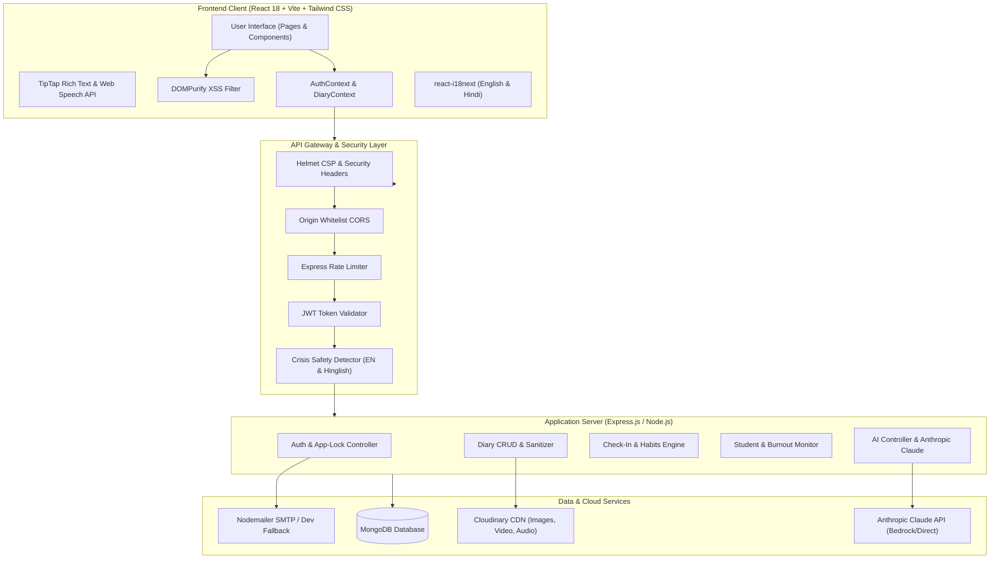
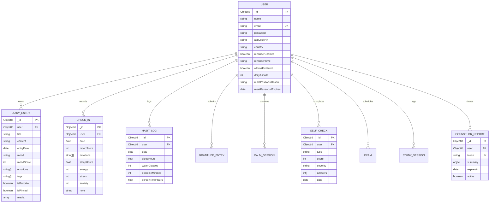

# MindDiary: AI-Supported Mental Wellness & Journaling Platform
## Academic Project Report & Technical Specification Outline

---

## 1. Introduction & Problem Statement

### 1.1 Problem Statement
Modern digital life places significant cognitive and psychological strain on individuals, especially university students. While self-reflection and expressive writing (journaling) are clinically established practices for emotion regulation, traditional physical diaries lack immediate feedback, pattern recognition, and crisis intervention safety nets. Conversely, modern commercial journaling and mental health applications often suffer from:
1. **Aggressive monetization & dark patterns:** Gating basic emotional tracking behind high subscription paywalls.
2. **Privacy breaches & commercial tracking:** Training third-party models or selling user emotional and sentiment data to advertisers.
3. **Clinical overreach & hallucinations:** Untested conversational agents making pseudo-medical diagnoses or suggesting pharmaceutical regimens.
4. **Lack of immediate crisis triage:** Failing to recognize acute distress signals (self-harm, suicidal ideation) and provide localized helpline routing.

### 1.2 Project Objectives
MindDiary is developed as a privacy-first, full-stack mental health sanctuary and expressive writing platform designed to:
- Provide an intuitive, calm digital journal with rich text, media uploads, and voice dictation.
- Offer daily micro check-ins, habit tracking, and clinical screening questionnaires (PHQ-9 and GAD-7).
- Deliver compassionate, non-diagnostic AI reflections and CBT thought restructuring via Anthropic Claude with strict deterministic rate limiting (30 requests/day per user) and system guardrails.
- Implement an automated, deterministic Crisis Safety Filter scanning for English and Hinglish distress signals, triggering localized emergency helplines (India Tele-MANAS/KIRAN, US 988, UK 111, Canada 988, Australia 13 11 14).
- Guarantee zero data leakage: user diary text is never used to train foundation models, and clinical exports shared with counselors contain only aggregated numerical metrics, strictly omitting personal journal text.

---

## 2. Literature Review & Comparative Analysis

| Feature | Daylio | Wysa | Youper | MindDiary (Our System) |
| :--- | :--- | :--- | :--- | :--- |
| **Primary Interaction** | Icon/Micro-tap | Conversational Chatbot | Conversational AI | Expressive Journaling + Holistic Wellness |
| **Rich Text & Voice** | Basic notes | Text chat only | Text chat only | TipTap Rich Text, Audio Dictation, Media |
| **AI Reflections** | None (Stats only) | Proprietary scripted AI | Proprietary CBT AI | Anthropic Claude with clinical safety guardrails |
| **Crisis Intervention** | Static FAQ link | Emergency SOS button | Redirect card | Multi-tier Real-time Detector (EN/Hinglish) + Country Helplines |
| **Standard Screenings** | None | PHQ-9 / GAD-7 (Paid) | Anxiety/Depression tests | Free Built-in PHQ-9 & GAD-7 scoring |
| **Data Privacy Policy** | Cloud synced | Commercial cloud | Cloud stored | Strict isolation, exportable JSON, zero AI training |
| **Counselor Report** | Export CSV (raw data) | Clinician dashboard | Export summary | 7-day expiring token summary (Zero raw text) |
| **Academic / Student Mode**| None | None | None | Exam stress tracker, Pomodoro timer, Burnout alert |

---

## 3. System Architecture

MindDiary follows a decoupled, three-tier microservice-ready architecture composed of a React 18 + Vite frontend Single Page Application (SPA), an Express.js Node.js API backend, and a MongoDB document database.

---

## 4. Database Schema (Entity-Relationship Design)

---

## 5. Core Functional Modules

1. **Expressive Journaling Engine:**
   - TipTap WYSIWYG rich text editor with auto-save drafts.
   - Cloudinary image, video, and voice memo attachment with client-side canvas downscaling (max 1600px).
   - Server-side `sanitize-html` and client-side `DOMPurify` protection against stored XSS attacks.
2. **Holistic Wellness & Tracking:**
   - 10-point mood slider, 20+ fine-grained emotional tags, sleep, energy, stress, and anxiety tracking.
   - Standard PHQ-9 (Depression) and GAD-7 (Anxiety) self-screening tools with score breakdowns.
   - 3-good-things Gratitude Jar and nostalgic Happy Box for positive reinforcement.
3. **Student Companion Module:**
   - Academic exam countdown tracker with stress trend visualization.
   - Pomodoro 25/5 focus timer with automatic rest/breathing prompts.
   - Non-diagnostic Burnout Early Notice triggered when stress $\ge 4$ on 5+ of last 7 days and sleep $< 6.5\text{h}$.
   - 3 daily "small wins" checklist.
4. **Clinical Safety & Crisis Routing:**
   - High-priority deterministic pattern matcher for self-harm and suicide phrases in English and Hindi/Hinglish.
   - Two-tier banner response: gentle caring card on 'concern'; modal crisis support with one-tap helpline call links and trusted contact SMS routing on 'high'.
5. **Ethical AI Assistance:**
   - Powered by Anthropic Claude via a server-side SDK wrapper with token budgets and a 30 calls/day quota.
   - Strict system prompt forbidding medical diagnoses, drug suggestions, or claiming human sentience.
   - CBT Thought Challenger (Situation $\to$ Automatic Thought $\to$ Evidence For/Against $\to$ Balanced Perspective).
6. **7-Day Counselor Summary Sharing:**
   - Generates a crypto-secure, 7-day expiring token for licensed counselors and therapists.
   - Shares only aggregated numerical averages and screening scores; strictly omits diary narrative texts.

---

## 6. Testing Strategy & Verification

| Module / Test Suite | Test Objective | Expected Outcome | Result |
| :--- | :--- | :--- | :--- |
| **Auth & App-Lock** | Rate limiting brute force PIN attempts (max 5) | Account locks for 5 minutes after 5 consecutive failed PINs | Passed |
| **Password Reset** | Single-use 30-min token verification & SHA-256 hash | Invalidated immediately after use; token cannot be re-used | Passed |
| **Crisis Safety** | Submitting suicidal phrases in English & Hinglish | Immediate flag `safety.level = "high"`, crisis banner triggered | Passed |
| **Input Sanitization**| Submitting malicious `<script>` tags in diary body | Stripped by `sanitize-html`; safe HTML retained | Passed |
| **Student Burnout** | 5 high stress days ($\ge 4$) + sleep $< 6.5\text{h}$ | Gentle non-diagnostic reminder surfaced without alarms | Passed |
| **Counselor Share** | Accessing `/api/wellness/shared/:token` | Summary returned with zero raw diary entry text | Passed |
| **AI Quota Guard** | Exceeding 30 Claude API calls in 24 hours | 429 Too Many Requests returned with daily reset notice | Passed |

---

## 7. Ethical Considerations, Privacy & Compliance

- **Zero Foundation Model Training:** MindDiary does not sell or provide user diaries to open AI training corpuses.
- **Data Minimization:** AI calls transmit only the active excerpt requested by the user, never the user's full diary history.
- **Complete User Ownership:** Users can download an unencrypted JSON backup of all their check-ins and journal entries at any time or permanently delete their account with cascading deletion.
- **Non-Diagnostic Stance:** Clear disclaimers clarify that MindDiary is a wellness companion and not a medical device or licensed healthcare professional.

---

## 8. Limitations & Future Scope

### Limitations:
- Speech recognition relies on the client browser's Web Speech API implementation.
- Real-time counselor communication is not available; reporting is asynchronous via expiring links.

### Future Scope:
- Offline-first Progressive Web App (PWA) with IndexedDB client synchronization.
- End-to-end encrypted zero-knowledge vault where server administrators cannot decrypt diary contents.
- Wearable integration (Google Fit, Apple Health) for automated sleep and heart rate variability (HRV) sync.
